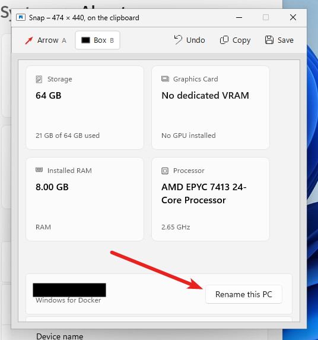
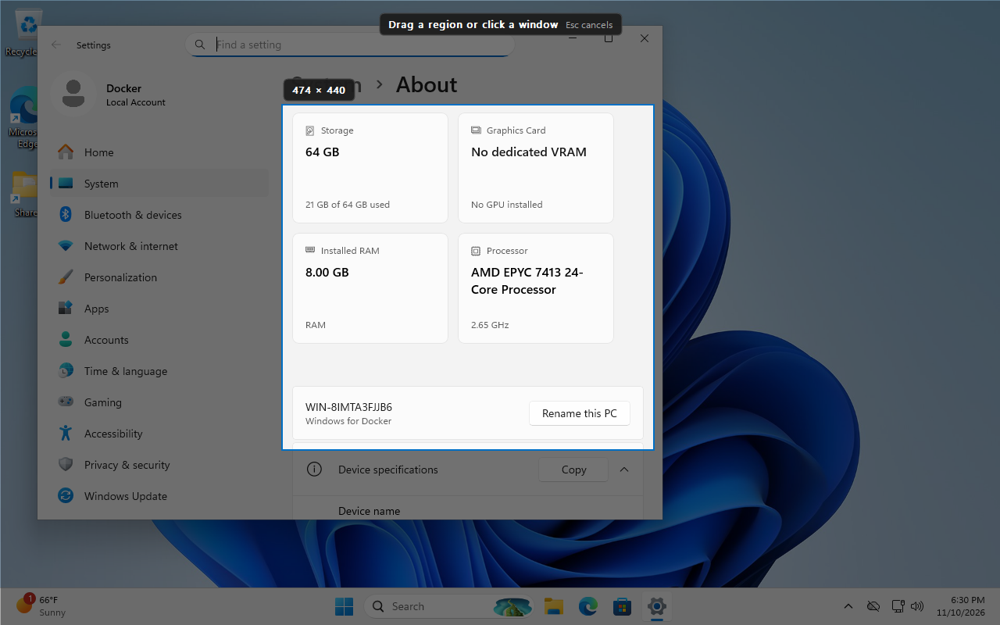
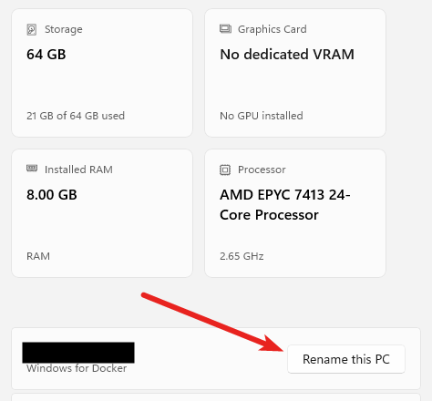
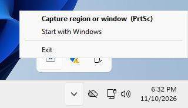

# Snap

**Fast screenshots for Windows. Point at something with an arrow, black out what shouldn't be seen, paste.**

Snap is a tiny free alternative to Snagit and the Snipping Tool. It does three things, and does them
instantly: grab part of your screen, add an arrow or a black box, and put the result on your clipboard.
No account, no settings, no installer of its own: it's a single small script.

## How it works

**1. Press PrtSc.** The screen freezes and dims. Drag a box around what you want, or just click a
window to take the whole window.

**2. Mark it up.** Snap opens what you grabbed. Drag to draw a **red arrow**, or press **B** and drag
to draw a **black box** over anything private (passwords, names, account numbers).

**3. Paste it anywhere.** It's already on your clipboard: email, Teams, Slack, Word, a ticket. Every
arrow and box you add updates the clipboard too, so there's nothing to save or export.

What gets pasted:

## Install (2 minutes)

Snap runs on **AutoHotkey v2**, a free, widely used Windows automation tool.

1. **Get AutoHotkey v2.** On the
   [latest AutoHotkey release](https://github.com/AutoHotkey/AutoHotkey/releases/latest), download
   `AutoHotkey_2.x_setup.exe` and run it (or click **Download** on [autohotkey.com](https://www.autohotkey.com/)).
   *Not allowed to install software at work?* Download `AutoHotkey_2.x.zip` from the same page
   instead and unzip it anywhere; nothing gets installed.
2. **Download Snap.** Right-click [snap.ahk](https://github.com/DanielGGordon/snagit/raw/main/snap.ahk)
   and choose **Save link as…** Put it somewhere permanent, such as your Documents folder.
3. **Run it.** Double-click `snap.ahk`. (With the portable zip, drag `snap.ahk` onto
   `AutoHotkey64.exe`.) Nothing pops up; Snap waits quietly in the system tray.
4. **Start it with Windows** (optional, recommended). Click the **^** arrow by the clock, right-click
   the Snap icon, and choose **Start with Windows**.

   

To stop Snap, choose **Exit** from that same menu. To uninstall, untick **Start with Windows**, exit,
and delete `snap.ahk`.

## Keys

| Key | What it does |
| --- | --- |
| **PrtSc** | Drag a region, or click a window (click the empty desktop for the whole screen) |
| **Win+Shift+S** | Same as PrtSc, replacing the Snipping Tool shortcut |
| **Alt+PrtSc** | Take the active window straight away |
| **Esc** or right-click | Cancel |

In the editor:

| Key | What it does |
| --- | --- |
| **A**, then drag | Red arrow: press where it starts, let go where it points |
| **B**, then drag | Solid black box |
| **Ctrl+Z** | Undo |
| **Ctrl+C** | Copy again, if you've copied something else since |
| **Ctrl+S** | Save as a PNG (Ctrl+S, Enter saves to `Pictures\Screenshots`) |
| **Esc** | Close |

## Good to know

- **Made for Windows 11**, and should work on Windows 10. Snap follows Windows' light or dark mode.
- If Windows is set to open the Snipping Tool with PrtSc, Snap still gets the key while it's running.
- If you already have AutoHotkey v1, install v2 alongside it; it picks the right version automatically.
- Tested on Windows 11. Not yet tested with multiple monitors or display scaling above 100%;
  [open an issue](https://github.com/DanielGGordon/snagit/issues) if something looks off.

## License

Public domain ([the Unlicense](LICENSE)). Use it, change it, rebrand it, sell it; no credit needed.
